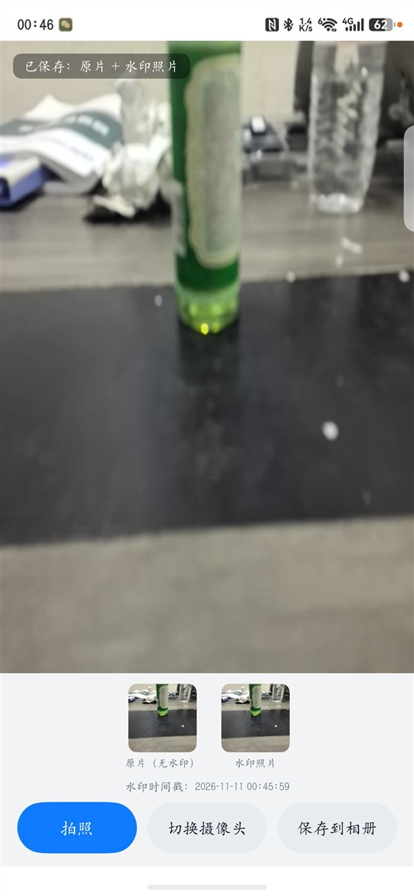
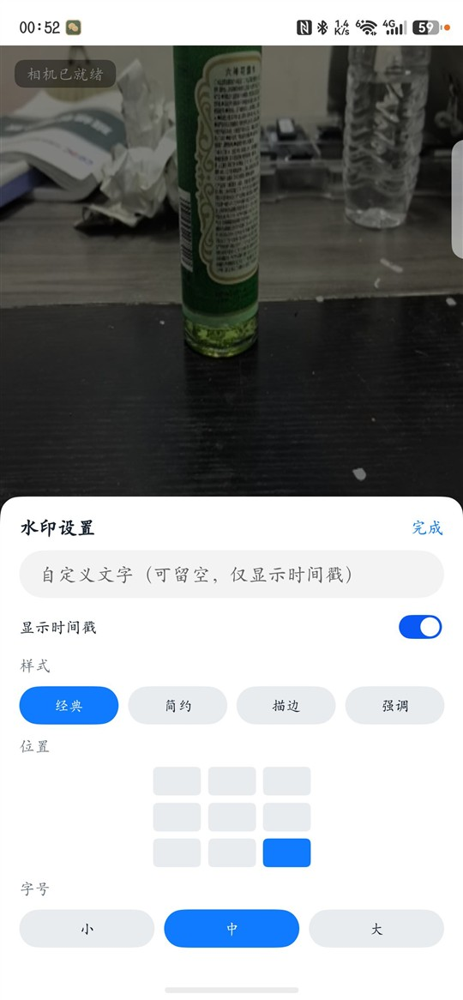
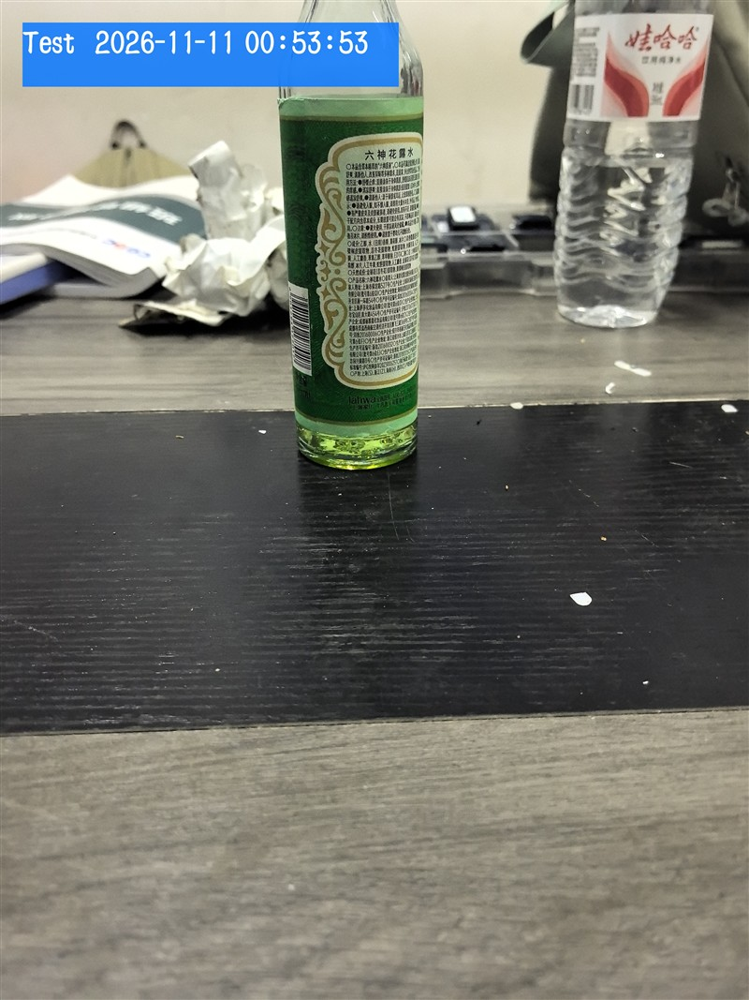
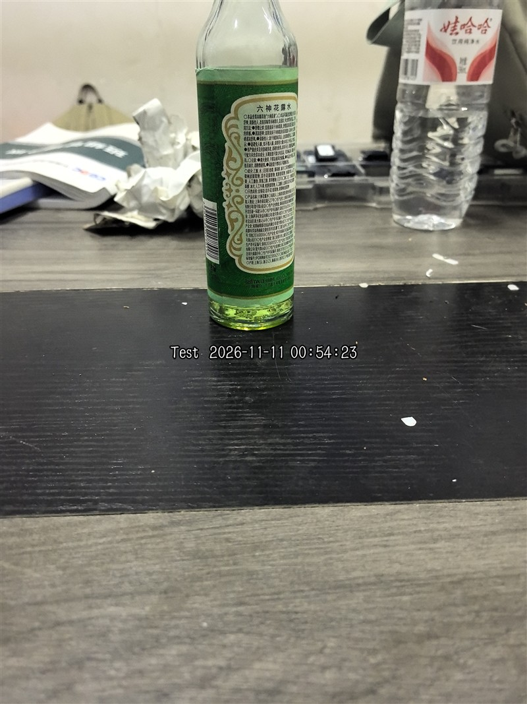
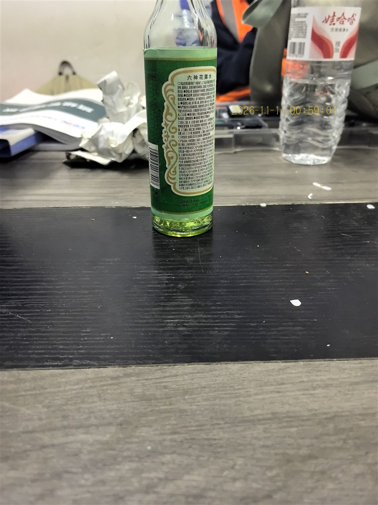
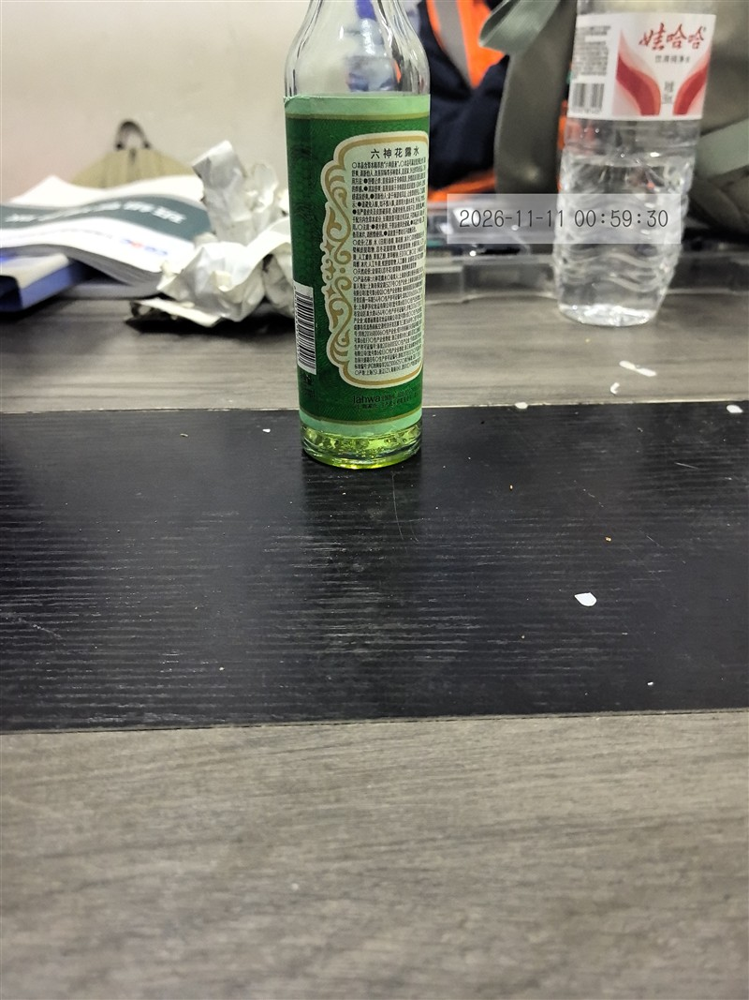
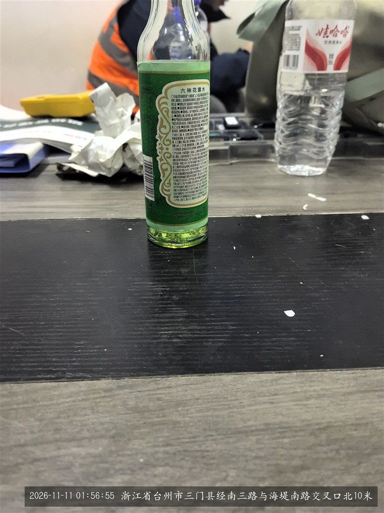
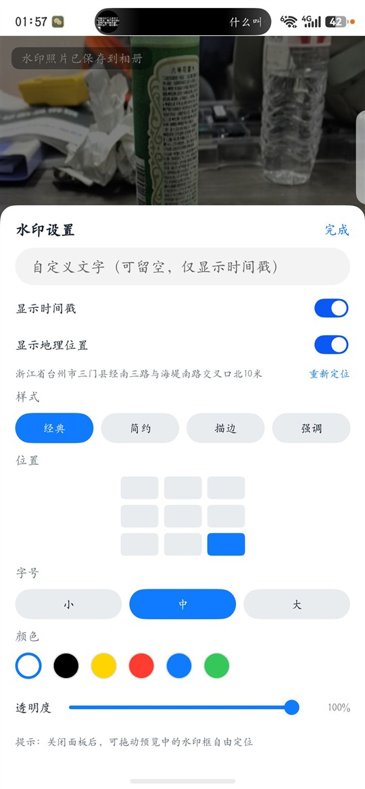

# 鸿蒙水印相机 (HarmonyOS Watermark Camera)

一个 HarmonyOS NEXT 拍照应用（ArkTS / Stage 模型）：

- 📷 **拍照**：CameraKit 相机预览与拍摄
- 🎯 **自动对焦**：默认连续自动对焦，点击预览任意位置即可对焦
- 🔍 **缩放**：底部滑杆 + 双指捏合（0.5x 起，最高至设备支持倍率）
- 🎨 **水印自定义**：文字、4 种样式、9 宫格位置、字号、颜色、透明度
- 📍 **地理位置水印**：自动定位并反查中文地址，可开关、可重新定位
- 🖱 **自由拖动位置**：预览上的虚线水印框可直接拖到任意位置
- ⏱ **时间戳水印**：把当前时间绘制进照片像素（保存后不可去除）
- 🖼 **保留无水印原片**：每次拍照同时保存两张照片
- 💾 **保存到相册**：可把带水印照片写入系统图库（可选）

> 本工程已在 DevEco Studio 26.0（内置 HarmonyOS SDK API 26）下**实际编译通过**，
> 并已在鸿蒙真机上安装运行、完成拍照全流程验证。
> 安装到设备前需在 DevEco Studio 中配置签名（本仓库不包含签名证书）。

## ✅ 真机验证结果

| 项目 | 结果 |
|------|------|
| 安装/启动 | 签名 HAP 安装成功，应用正常启动 |
| 相机预览 | 正常（前后置可切换） |
| 点击对焦 | 点击位置出现白色对焦圈，`setFocusPoint` + `FOCUS_MODE_AUTO` 生效 |
| 连续自动对焦 | 启动默认 `FOCUS_MODE_CONTINUOUS_AUTO` |
| 滑杆缩放 | 拖动滑杆到 **93.2x** 生效，倍率实时显示 |
| 双指缩放 | 双指外扩到 **5.0x** 生效，滑杆同步 |
| 默认倍率 | 启动回到 **1.0x**（避免默认停在 0.5x 超广角） |
| 自定义水印 | 文字 “Test” + 强调样式 + 左上角 + 大字号，正确渲染 |
| 样式/位置切换 | 描边样式 + 居中位置，正确渲染 |
| 颜色/透明度 | 黄色文字 + 60% 透明度 + 简约样式，正确渲染 |
| 拖动位置 | 虚线水印框拖到右上角，照片中水印落在对应位置 |
| 自动反色 | 经典样式 + 黑色文字，自动切换为白底黑字 |
| 地理位置 | 自动解析出“浙江省台州市三门县…”并写入水印 |
| 位置开关 | 关闭“显示地理位置”后，水印只保留时间戳 |
| 拍照保存 | 原片 **3072×4096**、水印片 **3072×4096**，均保存成功 |
| 无水印原片 | 右下角干净，无任何水印 |
| 时间戳水印 | 右下角半透明底 + 白色时间戳，已烘进像素 |
| 保存到相册 | 授权 `WRITE_IMAGEVIDEO` 后保存成功 |

效果截图：`docs/` 目录。

## 📸 效果预览

| 应用界面 | 水印设置 |
|----------|----------|
|  |  |

| 强调样式 · 左上 · 大字号 | 描边样式 · 居中 |
|--------------------------|------------------|
|  |  |

| 黄色 · 60% 透明 · 拖动到右上 | 经典 · 黑色文字（自动反色底衬） |
|------------------------------|--------------------------------|
|  |  |

| 地理位置水印 | 位置设置 |
|--------------|----------|
|  |  |

> 所有示例照片均为 App 实际拍摄输出：原片保持无水印，水印照片的水印已烘进像素。

---

## 一、功能说明

| 功能 | 实现 |
|------|------|
| 相机预览 | `XComponent(SURFACE)` + `CameraKit` 的 `PreviewOutput` |
| 拍照 | `PhotoOutput.capture(settings, callback)` |
| 自动对焦 | 启动 `setFocusMode(FOCUS_MODE_CONTINUOUS_AUTO)`；点击预览 `setFocusPoint(Point)` + `FOCUS_MODE_AUTO` |
| 缩放 | `getZoomRatioRange()` 读取范围，`setZoomRatio()` 设置；底部 `Slider` 与 `PinchGesture` 共用 |
| 水印样式 | 经典（黑底白字）/ 简约（阴影白字）/ 描边（白字黑边）/ 强调（蓝底白粗体） |
| 水印位置 | 3×3 九宫格，`position` 0~8（0 左上、4 居中、8 右下） |
| 水印字号 | 小 / 中 / 大（0.8 / 1.0 / 1.3 倍） |
| 水印颜色 | 6 种预设色：白/黑/黄/红/蓝/绿；强调样式用作底色，其余用作文字色，经典样式自动反色底衬 |
| 水印透明度 | 滑杆 0.2 ~ 1.0 |
| 自由位置 | 预览上的虚线水印框可拖动，坐标归一化到 0~1 |
| 地理位置 | `geoLocationManager.getCurrentLocation()` 取经纬度，`getAddressesFromLocation()` 反查地址；失败回退经纬度，长地址自动缩小字号 |
| 自定义文字 | `TextInput` 输入文字，与时间戳组合为 `文字  YYYY-MM-DD HH:mm:ss` |
| 获取照片 | `photoAvailable` 回调 → `camera.Photo.main.getComponent(JPEG)` |
| 原片保存 | JPEG 字节原样写入 `files/photos/original/`（**不含水印**） |
| 水印绘制 | `OffscreenCanvas` 绘制原图 + 右下角时间戳 → `getPixelMap()` |
| 水印编码 | `ImagePacker.packToData(pixelMap, {format:'image/jpeg'})` |
| 水印保存 | 写入 `files/photos/watermark/` |
| 保存到相册 | `photoAccessHelper.createAsset()` + 文件写入 |

### 保存位置

应用沙箱（无需存储权限，卸载应用后随应用删除）：

```
/data/storage/el2/base/haps/entry/files/photos/
├── original/    # 无水印原片
└── watermark/   # 带时间戳水印照片
```

界面底部会同时显示“原片”和“水印照片”两张缩略图，并展示水印时间戳，便于核对。

---

## 二、工程结构

```
HarmonyOSWatermarkCamera/
├── AppScope/
│   ├── app.json5                          # 应用级配置（bundleName: com.example.watermarkcamera）
│   └── resources/base/
│       ├── element/string.json            # 应用名称
│       └── media/app_icon.png             # 应用图标（512x512 已生成）
├── entry/
│   ├── build-profile.json5
│   ├── hvigorfile.ts
│   ├── oh-package.json5
│   ├── obfuscation-rules.txt
│   └── src/main/
│       ├── module.json5                   # 权限、Ability、页面路由
│       ├── ets/
│       │   ├── entryability/EntryAbility.ets    # 应用入口
│       │   ├── pages/CameraPage.ets             # 主页面：预览/拍照/保存
│       │   └── utils/WatermarkUtil.ets          # 水印绘制与图片编码
│       └── resources/base/
│           ├── element/string.json        # 界面文案
│           ├── element/color.json         # 颜色
│           ├── media/app_icon.png         # 模块图标
│           ├── media/startIcon.png        # 启动窗口图标
│           └── profile/main_pages.json    # 页面路由
├── build-profile.json5                    # compatibleSdkVersion 5.0.1(13)
├── hvigorfile.ts
├── oh-package.json5
├── hvigor/hvigor-config.json5
├── .gitignore
└── README.md
```

---

## 三、开发环境

本机已安装（无需重复安装）：

| 组件 | 路径 / 版本 |
|------|-------------|
| DevEco Studio | 26.0（Windows） |
| 内置 JDK | DevEco Studio 自带 `jbr`（OpenJDK 25） |
| HarmonyOS SDK | HarmonyOS 26.0.0 / API 26（SDK Manager 安装） |
| hvigor | DevEco Studio 自带（6.26.9） |
| ohpm | DevEco Studio 自带 |

如需在其它电脑安装：访问 [华为开发者联盟](https://developer.huawei.com/consumer/cn/) 搜索 **DevEco Studio 下载**，
安装后通过 SDK Manager 安装 HarmonyOS NEXT SDK。

---

## 四、构建与运行

### 方式 A：DevEco Studio（推荐）

1. **打开工程**：`File → Open` 选择本目录。
2. **配置签名**：`File → Project Structure → Signing Configs`，勾选
   **Automatically generate signature**（需登录华为账号）。
3. **连接设备**：手机开启开发者模式与 USB 调试，或启动模拟器。
4. 点击 ▶ **Run 'entry'**。相机功能需真机验证（模拟器通常无相机）。

### 方式 B：命令行构建（已验证）

```powershell
$base = "C:\Program Files\Huawei\DevEco Studio"   # 按实际安装路径修改
$env:JAVA_HOME = "$base\jbr"
$env:DEVECO_SDK_HOME = "$base\sdk"
$env:PATH = "$base\tools\node;$base\tools\ohpm\bin;$base\jbr\bin;$env:PATH"

cd HarmonyOSWatermarkCamera
node "$base\tools\hvigor\bin\hvigorw.js" --mode module -p product=default assembleHap --no-daemon
```

构建结果：`entry/build/default/outputs/default/entry-default-signed.hap`。
> 本机已在 `build-profile.json5` 中配置 DevEco 自动生成的调试签名（`signingConfigs`），
> 可直接安装到已连接设备；如签名失效，在 DevEco Studio 的 Signing Configs 中重新勾选自动签名即可。

---

## 五、使用步骤

1. 打开 App，首次启动申请 **相机权限**，请允许。
2. **对焦**：启动后自动连续对焦；点击预览任意位置，该位置出现白色对焦圈并触发一次自动对焦。
3. **缩放**：拖动底部滑杆，或在预览区双指捏合；倍率实时显示在滑杆左侧。
4. **水印设置**：点击底部 **水印** 按钮，可修改：
   - 自定义文字（留空则只显示时间戳）
   - 是否显示时间戳
   - 样式：经典 / 简约 / 描边 / 强调
   - 位置：3×3 九宫格任选
   - 字号：小 / 中 / 大
   - 颜色：白 / 黑 / 黄 / 红 / 蓝 / 绿
   - 透明度：0.2 ~ 1.0
   - 显示地理位置：自动定位并反查地址，可点 **重新定位**
   修改后点 **完成**，下次拍照生效。
5. **拖动位置**：关闭面板后，预览右下角会显示虚线水印框，按住它拖到任意位置即可自由定位（再次点九宫格会回到预设位置）。
6. 点击 **拍照**。
7. 自动保存两张：
   - **原片（无水印）** → `files/photos/original/`
   - **水印照片** → `files/photos/watermark/`（按当前水印设置渲染）
8. 页面底部显示两张缩略图与时间戳，可核对。
9. 点击 **相册** 可把水印照片写入系统图库（首次申请 `WRITE_IMAGEVIDEO`）。
10. 点击 **切换** 在前后置之间切换（切换后缩放回到 1.0x 并重新连续对焦）。

---

## 六、关键实现

### 水印为什么不可去除？

`WatermarkUtil.addTimestampWatermark()` 用离屏画布把时间戳**绘制进像素数据**，再重新编码为 JPEG。
保存后的文件本身包含水印像素，不是可关闭的 UI 叠加层。

### 原片为什么没有水印？

原片直接写相机输出的 JPEG 字节，**不经过任何画布绘制**，与相机直出内容一致。

### 水印样式与位置

| 样式 | 效果 |
|------|------|
| 经典 | 半透明底衬（按文字色自动反色）+ 自定义颜色文字 |
| 简约 | 无底衬，自定义颜色文字 + 对比色投影 |
| 描边 | 自定义颜色填充 + 对比色描边，适合复杂背景 |
| 强调 | 所选颜色底衬 + 自动黑/白粗体文字 |

位置为 3×3 九宫格（`position` 0~8，行优先），文字按所选格子的左/中/右与上/中/下对齐。
也可以关闭面板后拖动预览上的虚线水印框自由定位（`useCustomPosition` + 归一化 `x/y`）。

颜色与透明度：
- 颜色 6 种预设；**经典/简约/描边** 用作文字色，**强调** 用作底色并自动选择黑/白文字。
- 经典样式会根据文字颜色自动切换深色或浅色底衬，避免黑字黑底。
- 透明度 0.2~1.0，整体作用于底衬和文字。

地理位置：
- 启动时自动定位并反查地址，作为水印的第三段内容（文字 + 时间戳 + 地址）。
- 可在设置中关闭“显示地理位置”，或点“重新定位”刷新。
- 地址过长时自动缩小字号，保证一行不超出画面。

> 修改水印设置后，**下一次拍照**生效；已保存的照片不会回改。

### 权限

| 权限 | 用途 | 授予方式 |
|------|------|----------|
| `ohos.permission.CAMERA` | 预览与拍照 | 运行时弹窗 |
| `ohos.permission.APPROXIMATELY_LOCATION` | 模糊定位 | 运行时弹窗 |
| `ohos.permission.LOCATION` | 精确定位（地址解析） | 运行时弹窗 |
| `ohos.permission.INTERNET` | 地理编码网络请求 | 声明即可 |
| `ohos.permission.WRITE_IMAGEVIDEO` | 保存水印照片到相册 | 点击保存时申请 |

沙箱保存原片/水印片**不需要**存储权限。

---

## 七、常见问题

| 问题 | 处理 |
|------|------|
| 预览黑屏 | 确认相机权限；确认 `surfaceId` 在 `XComponent.onLoad` 后获取 |
| 拍照无反应 | 查看 `capture` 回调错误码；确认会话 `commitConfig()`/`start()` 成功 |
| 保存到相册失败 | 检查 `WRITE_IMAGEVIDEO` 是否授予 |
| 水印设置不生效 | 设置修改后需 **下次拍照** 才生效，已拍照片不受影响 |
| 点击对焦无效 | 部分设备/摄像头不支持 AF，`setFocusPoint` 会被忽略，属正常现象 |
| 缩放不生效 | 用 `getZoomRatioRange()` 确认设备支持范围；定焦摄像头可能只有 1.0x |
| 编译报 SDK 不匹配 | 确认 SDK ≥ API 13（`compatibleSdkVersion`，本机 DevEco 已写为 `26.0.0`） |
| 水印大小不合适 | 调整 `WatermarkUtil` 中 `fontSize = widthVp * 0.035` |

---

## 八、可扩展方向

- Logo / 图片水印
- 水印角度旋转、多种预设保存
- 拍照后大图预览、删除、分享
- 批量导出到相册
- 使用 `SaveButton` 安全控件保存，免权限弹窗

---

## 九、许可证

本项目基于 **Apache License 2.0** 开源，详见 [LICENSE](LICENSE)。

```
Copyright 2026 flounxisicoal

Licensed under the Apache License, Version 2.0 (the "License");
you may not use this file except in compliance with the License.
You may obtain a copy of the License at

    http://www.apache.org/licenses/LICENSE-2.0
```

